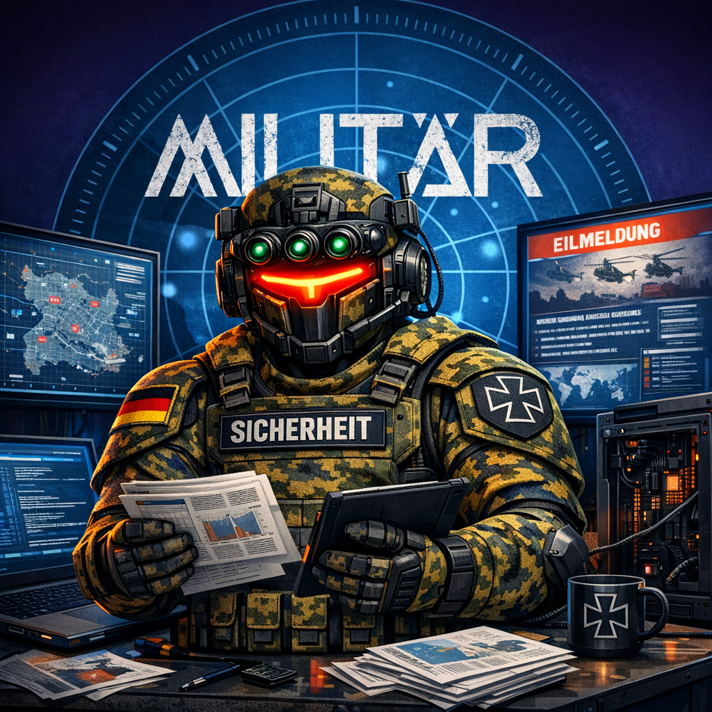

<p align="center">
  
</p>

# PTB-MN: posting pipeline bot

**PTB-MN** is the core of MilitärNews' news distribution. It posts and edits content in the MilitärNews channels and keeps the posts in sync across all language channels.

📖 Manual for editors: [militaernews.github.io/ptb-mn](https://militaernews.github.io/ptb-mn/) (German)

## Features

The bot covers the core posting pipeline:

* **Automatic posting:** processes news posts and media and publishes them to the main channels.
* **Multi-language sync:** translates every post into 10+ languages and sends it to the matching channel (DeepL, with Google Translate, the offline Argos Translate and a local Ollama model as fallbacks).
* **Edit sync:** edits to a source post are applied to every published copy.
* **Breaking news & announcements:** special formatting for breaking news and announcements.
* **Media handling:** downloads images and videos from social networks (Twitter/X, Instagram, YouTube).
* **Promotion:** publishes promotional posts and partner adverts.
* **Memes:** posts memes to the meme channel.
* **Private chat:** admin tools such as `/synthesize`, in English or German depending on the user's Telegram language.

## Running it

The bot runs as a container. GitHub Actions builds `ghcr.io/militaernews/ptb-mn:latest` on every push to `main`; `ptb-mn.container` is a Podman Quadlet unit for it with `AutoUpdate=registry`, so the server picks up new images automatically.

### Local development
```bash
pip install -r bot/requirements.txt
cp .env.example .env   # then fill in the values
cd bot && python main.py
```

### With Quadlet
```bash
cp ptb-mn.container ~/.config/containers/systemd/
# put the .env next to the checkout (see Configuration)
systemctl --user daemon-reload
systemctl --user start ptb-mn
journalctl --user -u ptb-mn -f
```

## Configuration

Environment variables (`.env`):

| Variable | Description |
|---|---|
| `TELEGRAM` | Telegram bot token |
| `DATABASE_URL` | PostgreSQL connection URL |
| `DEEPL` | DeepL API key for translations |
| `CHANNEL_SOURCE` | Channel the posts are written in |
| `CHANNEL_MEME` | Meme channel id |
| `ADMINS` | Admin user ids, comma-separated (a JSON array works too) |
| `LOG_GROUP_ID`, `THREAD_ID` | Group and topic for error reports (ptb-kit `ErrorReporter`) |
| `OPENROUTER_API_KEY` | OpenRouter key for the AI assistant |
| `OLLAMA_HOST`, `OLLAMA_MODEL` | Local Ollama server, last-resort translation fallback |
| `CONTAINER` | `true` when running in the container |

## Structure

* `bot/channel/`: channel logic (posting, editing, special handlers).
* `bot/social/`: Twitter/X and WhatsApp integrations.
* `bot/private/`: admin commands, adverts and promotion.
* `bot/data/`: database access and the language channels.
* `bot/util/`: media downloads, translation and helpers.
* `bot/res/`: images (the bot's avatar is `res/img/profile.jpg`, set with `/set_cmd`), flags, templates and `strings/<lang>.json` for the private-chat texts ([ptb-kit](https://github.com/militaernews/ptb-kit) `Strings`).
* `docs/`: the editors' manual, published with GitHub Pages.

### Languages
Posts go out in German, English, Turkish, Persian, Russian, Portuguese, Spanish, French, Italian, Arabic and Indonesian.

## Development

```bash
python -m pytest test/
docker build -t ptb-mn:latest .
```
